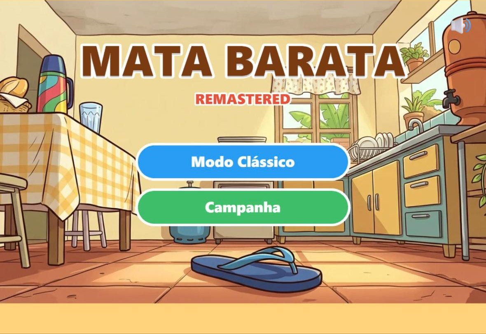
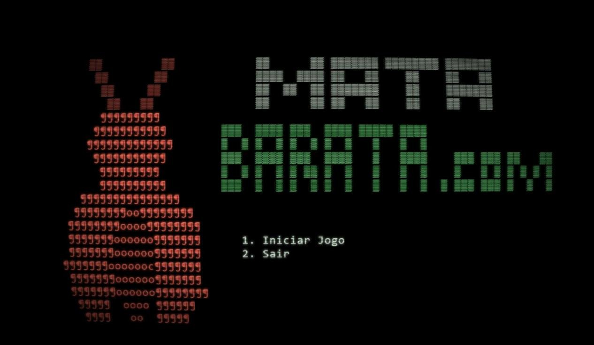
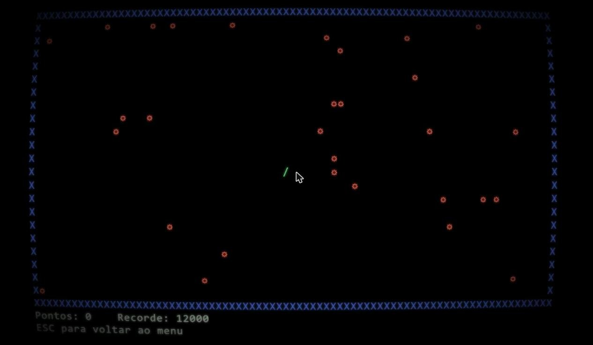
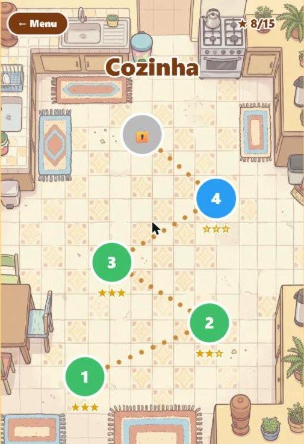
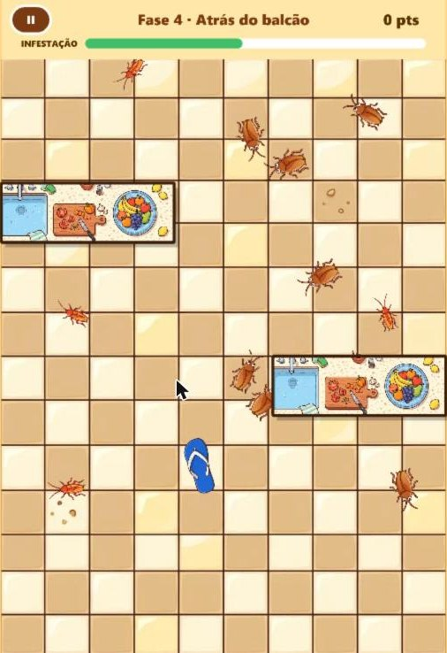
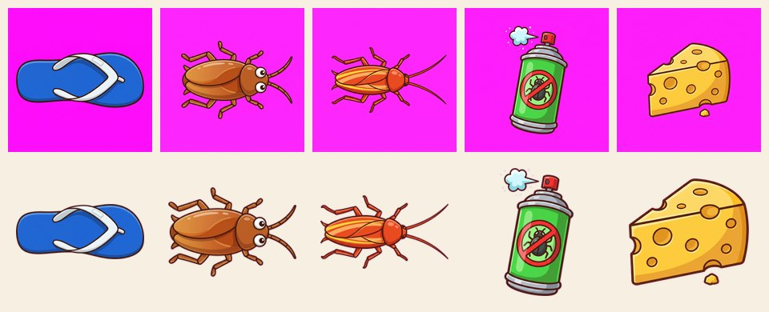

# MataBarata Remastered

**Um jogo de console que eu fiz em C++ no SENAI, em 2013, refeito do zero pro navegador e pro celular.**

### ▶ [Jogar agora](https://jeffersonmds.github.io/matabarata/)

Funciona no PC (mouse ou teclado) e no celular (toque). No iPhone, abra no Safari → Compartilhar →
**Adicionar à Tela de Início**: ele vira um app com ícone, abre em tela cheia e joga sem internet.



---

## Por que esse projeto existe

Em 2013, no curso do SENAI, eu escrevi um joguinho de terminal chamado **MataBarata**. Era um arquivo só,
`1RV_Lop_baratas.cpp`, usando a biblioteca `conio2`:

- um cursor que gira (`|` `/` `-` `\`) e **anda sozinho** na direção da última tecla, como no jogo da cobrinha;
- 30 baratas paradas, espalhadas pela tela;
- passar por cima de uma barata dá **+1000 pontos e um bip**, e o cursor fica mais rápido;
- encostar na borda é **game over**, com uma melodiazinha tocada no `Beep()` do Windows;
- matou todas, venceu.

Mais de dez anos depois, revirando uma pasta antiga do Google Drive com as coisas do SENAI, achei o código ainda lá.
Deu vontade de ver aquilo de novo, e de ver até onde dava pra levar uma ideia tão simples. O remake tem duas metas:

1. **Guardar o original do jeito que era.** O Modo Clássico segue as regras do `.cpp` à risca: a mesma arena de
   80×25, a mesma posição inicial, a mesma velocidade (100 ms por passo, 3 ms a menos por barata), a mesma melodia
   de game over e a mesma barata em ASCII na abertura.
2. **Fazer um jogo novo e bonito em cima da mesma ideia**, que dá pra jogar no celular, numa fila ou no sofá.
   É a Campanha.

E foi uma desculpa pra testar um jeito novo de fazer software. O jogo inteiro foi construído em parceria com o
[Claude Code](https://claude.com/claude-code), que escreveu o código seguindo os documentos de design e os planos
em [`docs/superpowers/`](docs/superpowers/). A arte foi gerada no Google Flow.

---

## Os dois modos

### Modo Clássico: a homenagem

| Abertura (igual à de 2013) | Jogando |
|---|---|
|  |  |

A arte da abertura foi extraída direto do `show_introducao()` do código original, caractere por caractere. A
única coisa nova é o efeito de tela de tubo (linhas de varredura, curvatura e brilho), feito com um shader. Os sons
são ondas quadradas com as mesmas frequências e durações dos `Beep()` de 2013.

### Campanha: o jogo novo

| Mapa da Cozinha | Fase em jogo |
|---|---|
|  |  |

Você é um **chinelo**. Ele segue o mouse ou o dedo, e basta encostar numa barata pra matar ("PAF!").

- As baratas **fogem** de você e **se multiplicam** com o tempo. Se a barra de infestação passar do limite, você perde.
- Mesas e balcões viram **esconderijo**: a barata passa por baixo, o chinelo não entra.
- **Power-ups:** inseticida (deixa todas lentas), chinelada (o próximo golpe mata em área) e isca (atrai as baratas).
- **Combo:** acertos seguidos rápidos valem mais (100, 150, 200…).
- **1 a 3 estrelas por fase:** uma por vencer, outra por vencer rápido e mais uma por nunca deixar a infestação
  passar da metade.
- 5 fases na Cozinha, liberadas uma a uma. O progresso fica salvo no navegador.

## Como jogar

| | PC | Celular |
|---|---|---|
| **Clássico** | setas ou WASD; Esc volta | deslizar o dedo |
| **Campanha** | o chinelo segue o mouse; Esc pausa | o chinelo segue o dedo |

---

## Do Google Flow pro jogo

Toda a arte da campanha saiu do **Google Flow** (modelo de imagem Nano Banana): fundos, móveis, mapa, ícone,
personagens e power-ups. Os prompts estão em [`docs/prompts-flow.md`](docs/prompts-flow.md), todos com o mesmo
guia de estilo no fim, pra tudo combinar.

O Flow não gera fundo transparente. Por isso os personagens são pedidos num **fundo magenta puro**, e o script
[`scripts/prep-sprites.py`](scripts/prep-sprites.py) transforma o magenta em transparência: suaviza a borda, tira a
"franja" rosa, corta as sobras e salva em PNG. Os originais ficam em [`art/flow/`](art/flow/).



O som não usa arquivo nenhum. Os efeitos ("PAF!", combo, filhote nascendo, power-up, vitória e derrota) e a
musiquinha 8-bit da Cozinha são **sintetizados na hora** com Web Audio. Não tem licença de terceiros e funciona
offline.

---

## Por dentro

- **[Phaser 3](https://phaser.io/) + TypeScript + [Vite](https://vite.dev/)**, publicado como site estático no
  GitHub Pages e instalável como **PWA**, que funciona offline.
- **Toda regra de jogo é TypeScript puro**, em [`src/logic/`](src/logic/), sem depender do Phaser: as regras de 2013,
  o comportamento das baratas, a infestação, o combo, as estrelas e o progresso. As cenas em
  [`src/scenes/`](src/scenes/) só desenham e repassam o toque. Por isso dá pra testar tudo sem abrir o navegador:
  **89 testes** com [Vitest](https://vitest.dev/).
- **As fases são arquivos JSON** em [`src/levels/`](src/levels/): baratas de cada tipo, ritmo de multiplicação,
  limite de infestação, móveis e power-ups. Um teste valida todas, inclusive se a 3ª estrela é possível em cada uma.
- **Cada push no `master`** roda os testes e publica sozinho (GitHub Actions).

```bash
npm install
npm run dev      # servidor local
npm test         # testes
npm run build    # build de produção em dist/
```

## Próximos passos

- [ ] **Banheiro** (fases 6–10) com a barata **Mãe**, que bota filhotes, e a **Escondida**
- [ ] **Quintal** (fases 11–15) com a barata **Voadora** e a infestação final
- [ ] Modo infinito
- [ ] Ajustar a dificuldade jogando

O design completo está em
[`docs/superpowers/specs/2026-10-24-matabarata-remastered-design.md`](docs/superpowers/specs/2026-10-24-matabarata-remastered-design.md).
